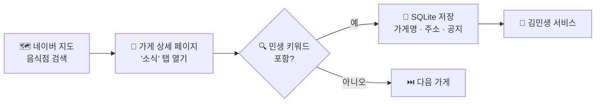

<div align="center">

### 🍜 쿠폰 쓸 수 있는 가게, 김민생이 대신 찾아드려요


</div>

<br/>

## 💡 왜 만들었나요?

**민생회복 소비쿠폰**을 받았는데, 막상 어느 가게에서 쓸 수 있는지 찾기가 어렵다는 점에서 출발했어요.
사장님들은 네이버 지도 **'소식'** 탭에 *"소비쿠폰 사용 가능합니다!"* 같은 공지를 올리지만, 하나하나 눌러 보지 않으면 알 수가 없죠.

**김민생**은 이 공지들을 자동으로 모아서, 쿠폰을 쓸 수 있는 가게를 한곳에서 보여주는 서비스예요.

<br/>

## ✨ 주요 기능

| | 기능 | 설명 |
|:-:|---|---|
| 🤖 | **사용처 자동 수집** | 네이버 지도 가게 '소식' 글에서 민생 쿠폰 관련 공지를 찾아 저장 |
| 🗺️ | **지역 · 업종별 검색** | 수집한 가게를 자치구, 업종별로 분류해서 검색 |
| 🏪 | **가게 직접 등록** | 사장님이 직접 가게를 등록하고 정보를 관리 |
| ⭐ | **즐겨찾기** | 자주 가는 가게 저장 (기기 안에만 저장돼요) |

<br/>

## ⚙️ 어떻게 동작하나요?



크롤러는 가게를 하나씩 열어 '소식' 글을 확인하고, 아래 키워드가 들어 있으면 저장해요.

`민생지원금` `민생회복` `민생 쿠폰` `민생소비쿠폰` `민생소비` `소비쿠폰`

<br/>

## 📊 수집 결과 미리보기

크롤러를 시험 실행해서 **서울 11개 자치구, 25곳**의 사용처를 모았어요.

| 가게 | 지역 | 공지 내용 |
|---|---|---|
| 연남토마 성수점 | 성동구 | 민생회복 소비쿠폰 사용가능합니다! |
| 샤브올데이 서울고척점 | 구로구 | 📢 민생회복 소비쿠폰 사용 가능 안내 |
| 취링취링 화곡역 본점 | 강서구 | 민생회복 소비쿠폰 사용가능 |

> 전체 목록은 [`data/stores_sample.csv`](data/stores_sample.csv)에서 바로 볼 수 있어요.

<br/>

## 📁 프로젝트 구조

```
Kim-Min-Saeng/
├── 📄 README.md
├── 🔒 index.html                  # 개인정보 처리방침 페이지
├── 🤖 crawler/
│   ├── naver_map_crawler.py       # 네이버 지도 '음식점' 검색 결과 크롤러 (무한 스크롤)
│   ├── seoul_food_crawler.py      # '서울시 음식점' 검색 + 페이지 넘김 크롤러
│   ├── keywords.txt               # 민생 관련 검색 키워드 목록
│   └── requirements.txt
└── 🗄️ data/
    ├── raw_results.sqlite         # 크롤링 원본 DB (가게명 · 주소 · 공지 · 수집 시각)
    ├── stores_sample.csv          # 위 DB를 깃허브에서 바로 볼 수 있게 CSV로 변환
    └── kimminsaeng.db             # 서비스용 DB (테이블 구조만 있음)
```

<br/>

## 🚀 실행 방법

```bash
# 1. 라이브러리 설치
pip install -r crawler/requirements.txt

# 2. 크롤러 실행 (크롬 브라우저가 열리며 자동으로 수집해요)
python crawler/naver_map_crawler.py
```

- 수집 결과는 `data/raw_results.sqlite`에 쌓여요. 어느 폴더에서 실행해도 같은 곳에 저장돼요.
- 크롬 브라우저가 설치되어 있어야 해요. Selenium 4.10 이상은 드라이버를 자동으로 준비해줘요.
- 화면 없이 돌리고 싶다면 코드의 `--headless` 줄 주석을 풀어주세요.

<br/>

## ⚠️ 참고

- 네이버 지도 화면 구조가 바뀌면 CSS 선택자를 다시 맞춰야 할 수 있어요.
- 사이트에 부담을 주지 않도록 요청 사이에 대기 시간을 두고 수집해요.
- 개인정보 처리방침은 [`index.html`](index.html)에서 확인할 수 있어요.


